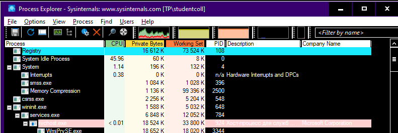
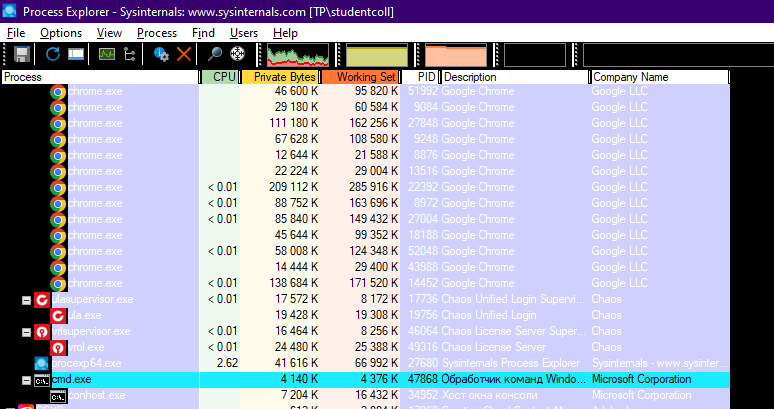
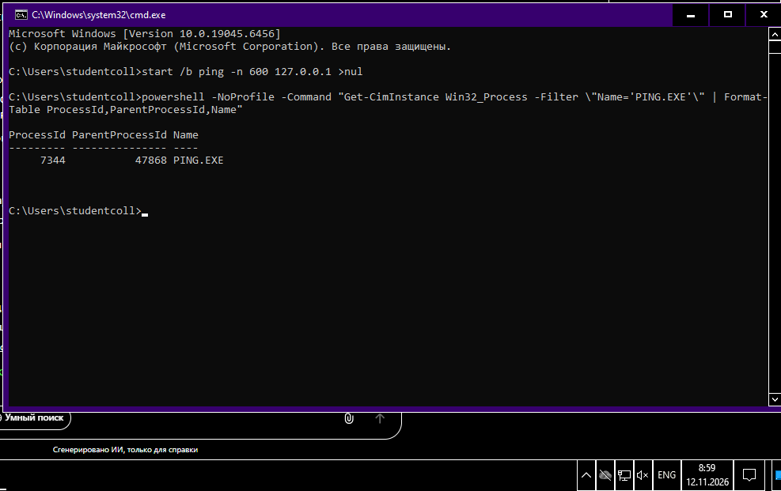
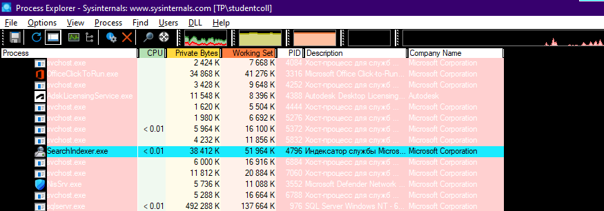
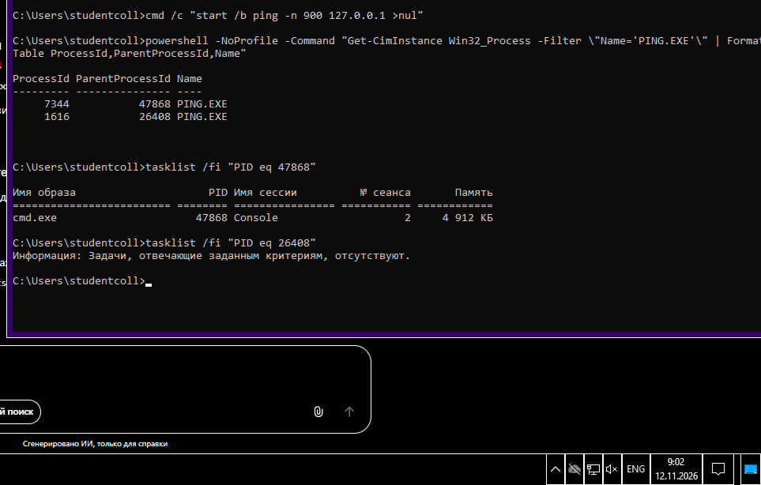
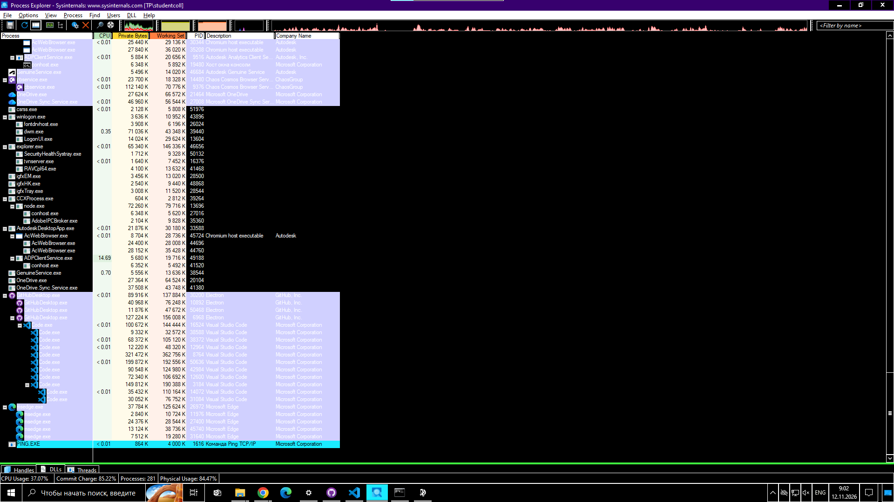

# ЛР 4. Дерево процессов

Система: Windows 10

## Дерево
Процесс в начале дерева и его номер: System Idle Process, PID 0 (далее System, PID 4)
Цепочка родителей терминала (имя и номер): procexp64.exe → cmd.exe (PID 4372)
Дочерний процесс: номер 31216, родитель 4372 (PING.EXE)
Команда, которой проверен родитель: powershell -NoProfile -Command "Get-CimInstance Win32_Process -Filter \"Name='PING.EXE'\" | Format-Table ProcessId,ParentProcessId,Name"
Процессов у браузера и имя процесса вкладок: множество процессов msedge.exe, главный процесс 25580, дочерние процессы вкладок также называются msedge.exe (например, PID 24292, 22820)

## Сирота
Номер сироты: 13048 (PING.EXE)
Номер родителя до и после завершения настоящего родителя: 36528 (временный cmd.exe, который завершился)
Где сирота стоит в дереве: у левого края (в корне дерева), так как Process Explorer не может нарисовать ветку к несуществующему родителю.

Не получилось: всё получилось

## Снимки экрана

