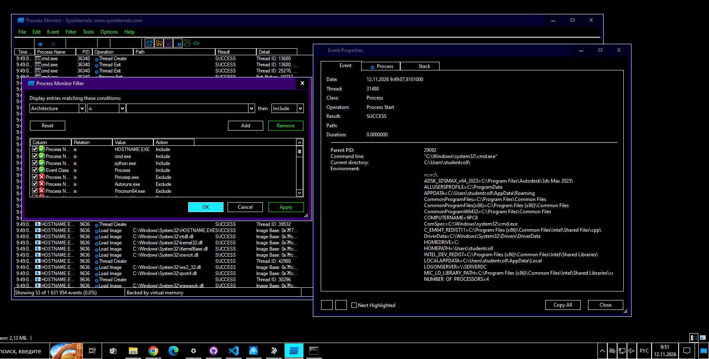
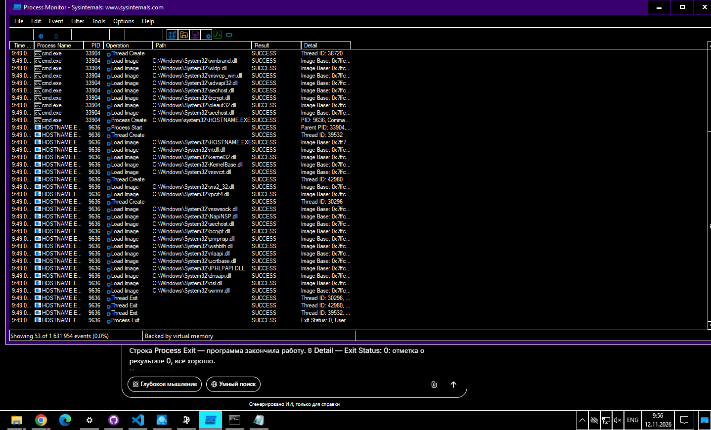
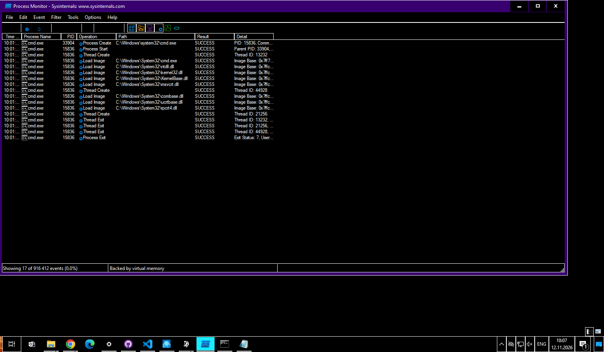
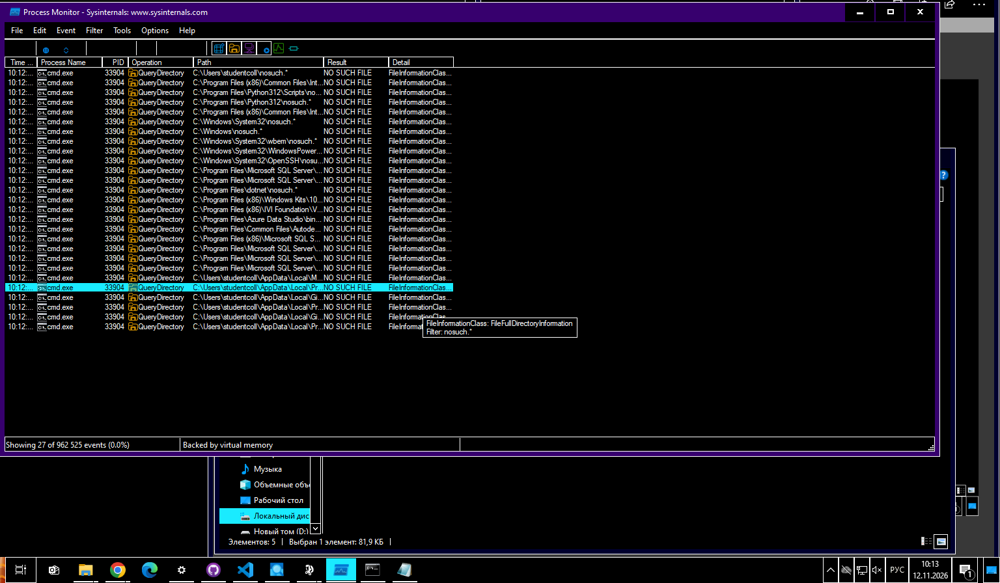
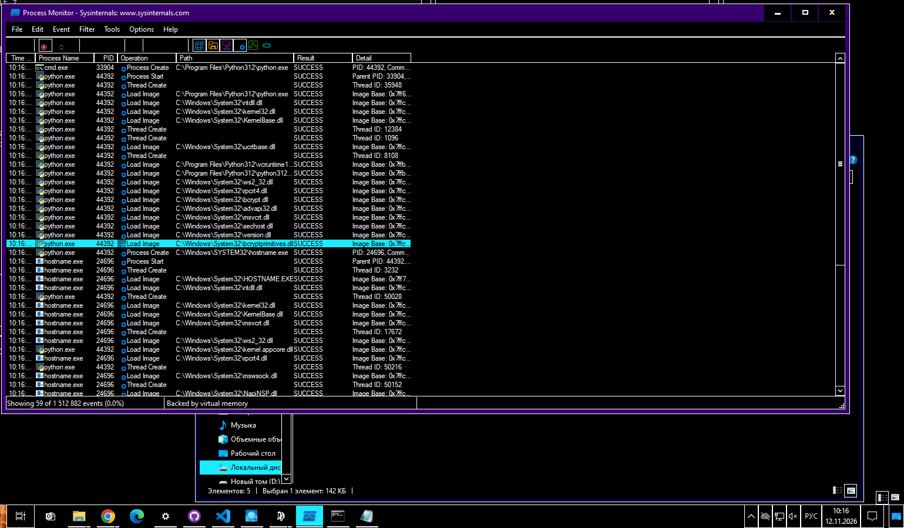

# ЛР 5. Рождение процесса

Система: Windows 10 (делал на ПК в колледже)
Программа записи: Process Monitor

## Рождение
Родитель (имя и номер): cmd.exe, PID 36340
Номер нового процесса: 9636 (HOSTNAME.EXE)
Событие или вызов, которым создан процесс: Process Create (у родителя) / Process Start (у ребенка)
Библиотек загружено и первая из них: 18 (не считая самой программы HOSTNAME.EXE, которая тоже отображается как Load Image), первая: ntdll.dll

## Завершение
Код завершения у ребёнка и у родителя: 7
Программа nosuch: папок проверено 27, ошибка 9009, код 9009

## Запуск из Python
Номер Python и номер ребёнка: Python 44392, ребёнок (hostname.exe) 24696
Чем запуск из Python отличается от запуска из оболочки: Ничем не отличается, Python (через subprocess.run) подаёт ядру ту же самую заявку (CreateProcessW), что и командная строка cmd.exe.

Не получилось: всё получилось

## Снимки экрана

Сохраните снимок поверх заглушки в папке `screenshots/` с тем же именем — ссылки ниже менять не нужно.

### 1. Рождение процесса
Шаг 1. Видно: запись запуска `hostname`: родитель создаёт процесс, у нового процесса номер родителя.

### 2. Библиотеки нового процесса
Шаг 2. Видно: библиотеки, которые загрузил `hostname`, и первая из них.

### 3. Код завершения 7
Шаг 3. Видно: завершение ребёнка с кодом 7 и тот же код у родителя.

### 4. Программы нет
Шаг 4. Видно: поиск `nosuch` по папкам из PATH и ошибка «не найдено».

### 5. Запуск из Python
Шаг 5. Видно: Python создаёт процесс `hostname`: номер Python и номер ребёнка.

