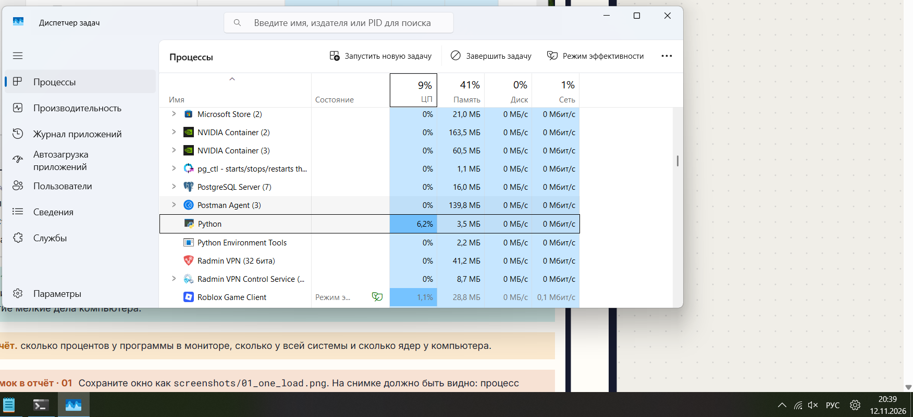
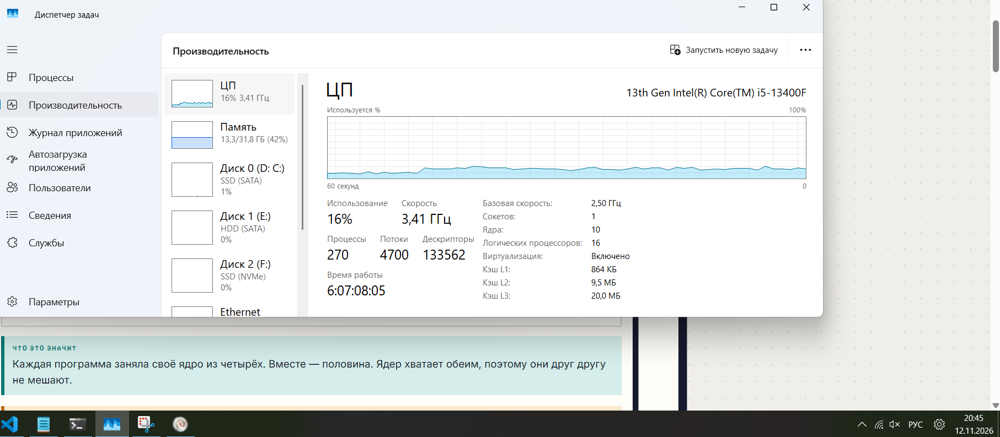
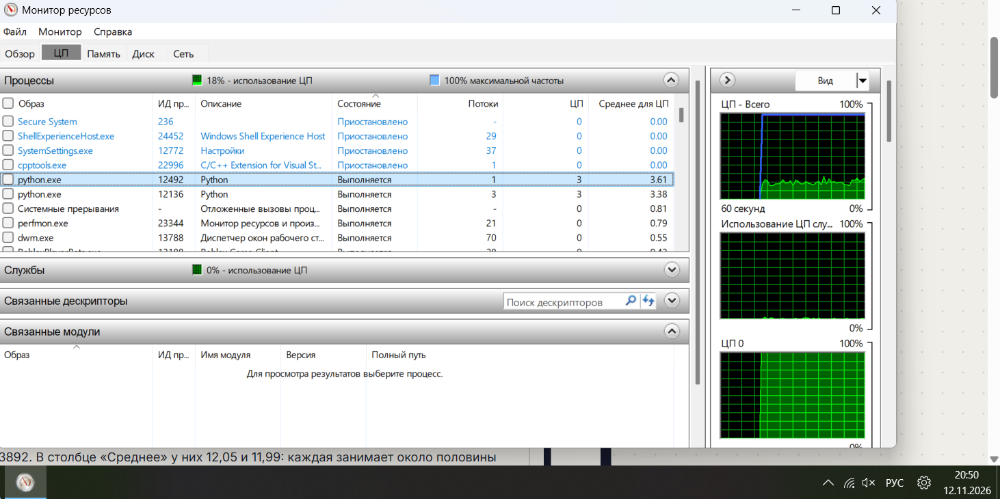
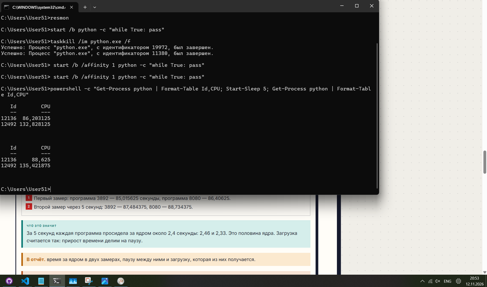

# ЛР 6. Кто загружает процессор

Система: Windows 11
Ядер (логических процессоров): 16

## Одна нагрузка
Процент процесса в мониторе: 6.2%
Общая загрузка: 9% (по данным Диспетчера задач), 15% (по данным Монитора ресурсов)
На каких ядрах видна нагрузка: Нагрузка видна на общем графике. Программа не сидит на одном месте, планировщик Windows пересаживает её с ядра на ядро.

## Две нагрузки
Проценты обеих нагрузок и общая загрузка: Проценты обеих нагрузок примерно по 6% (каждая занимает одно логическое ядро из 16), общая загрузка системы 16%.
На одном ядре (в macOS - фоновый режим): Общая загрузка остается 16%, но график ЦП 0 становится сплошной полосой 100%, так как две программы делят одно ядро пополам. Два python.exe - 12492 и 12136. В Среднее у них 3,61 и 3,38 так как программ 2 и они ограничены одним ядром, каждая занимает половину этого ядра. Занятость всех ядер вместе - 18%.

## Процессорное время
Первый замер, второй замер, пауза: Первый замер: программа 12136 - 86,203125 секунды, программа 12492 - 132,828125. Второй замер через 5 секунд: 12136 - 88,625, 12492 - 135,421875. Пауза: 5 секунд.
Загрузка по замерам: Программа 12136 прибавила за 5 секунд 2,42 секунды процессорного времени (88,625 - 86,203) = 48,4% ядра. Программа 12492 прибавила за 5 секунд 2,59 секунды (135,421 - 132,828) = 51,8% ядра. В сумме две программы занимают 100% одного ядра.
Почему процент в мониторе не говорит о скорости работы: Процент показывает лишь долю времени, когда ядро было занято. Если процессор работает на низкой частоте (или это энергоэффективное ядро), программа выполнит гораздо меньше работы, хотя процент загрузки будет тем же.

Всё получилось (принудительно остановил два процесса - 12492 и 12136. Занятость всех ядер упала к 6%)

## Снимки экрана

