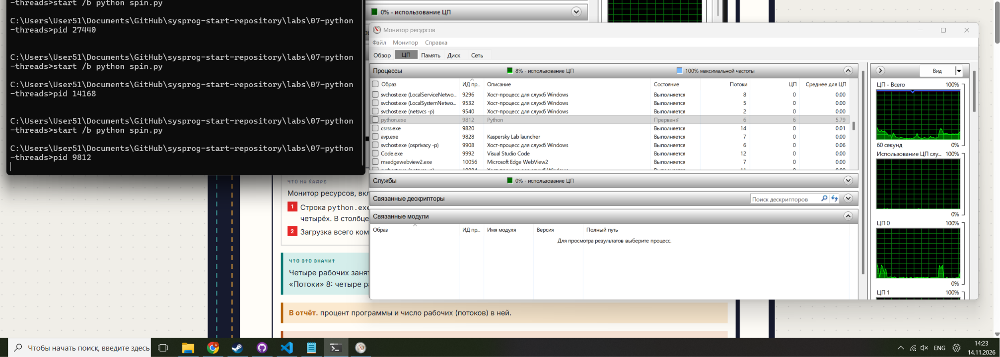
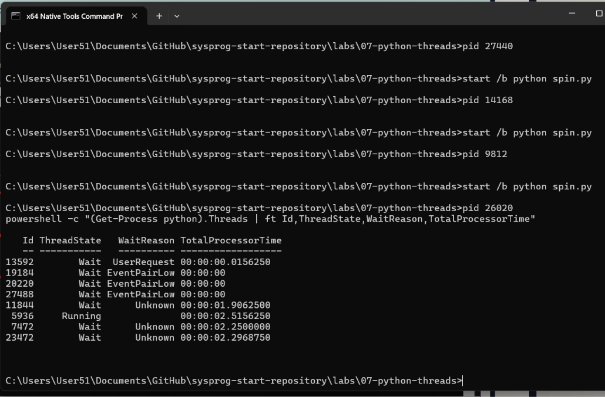
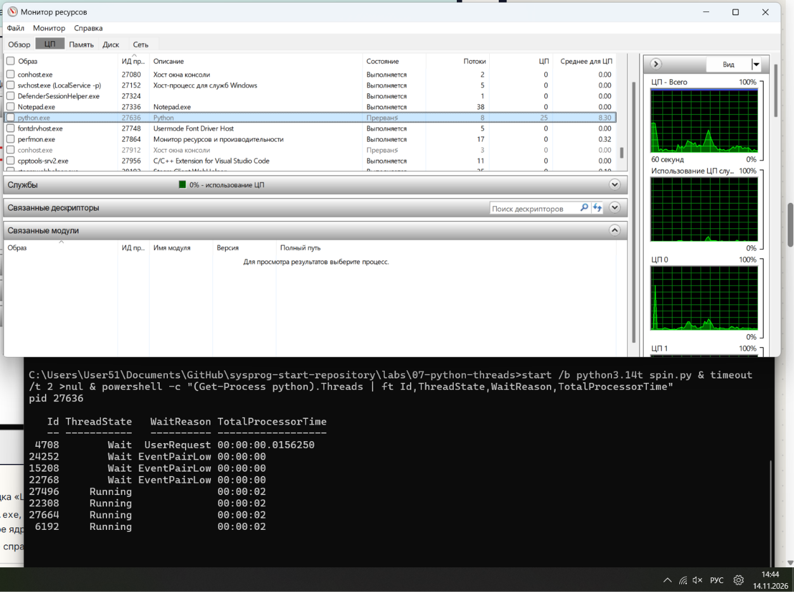
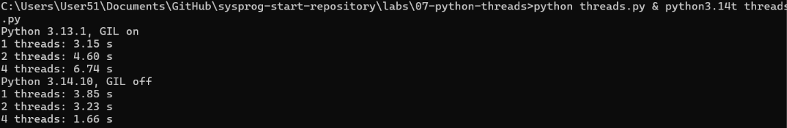

# ЛР 7. Потоки Python и GIL

Система: Windows 11
Ядер (логических процессоров): 16
Версии Python (обычный и без GIL): Python 3.13.1, Python 3.14.10

## Python с GIL
Процент процесса и число потоков: Строка python.exe - 9812. «ЦП» - 6. В столбце «Потоки» - 6.
Сколько потоков выполняется одновременно: Всего потоков в программе: 8. Работает одновременно: 1.

## Python без GIL
Процент процесса и проценты потоков: Процент программы: ~100%. Проценты рабочих (потоков) без замка: 4 потока работают одновременно (Running).

## Время работы
С GIL, 1 / 2 / 4 потока: 3.15, 4.60, 6.74 с.
Без GIL, 1 / 2 / 4 потока: 3.85, 3.23, 1.66 с.
Без GIL с PYTHON_GIL=1: 3.91 с, 6.46 с, 4.42 с.
Ожидание, 1 и 4 потока: 1 рабочим: 2.00 с. 4 ждущими рабочими: 2.00 с.
Почему ожидающие потоки ускоряются и с GIL: Потому что при ожидании (time.sleep) поток отпускает GIL, позволяя остальным потокам тоже заснуть одновременно.

Не получилось: всё получилось

## Снимки экрана

