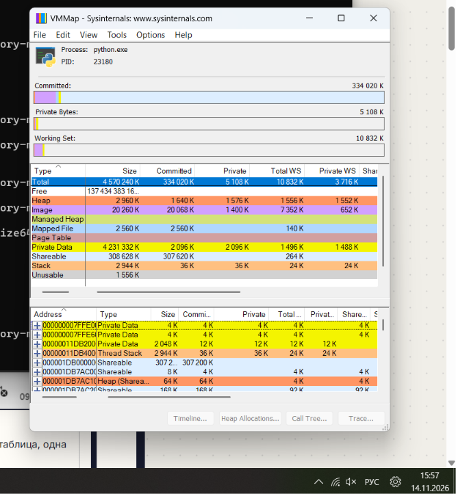
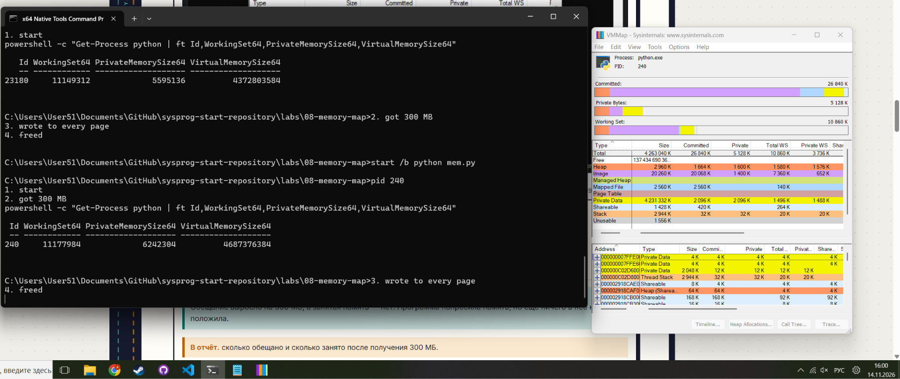
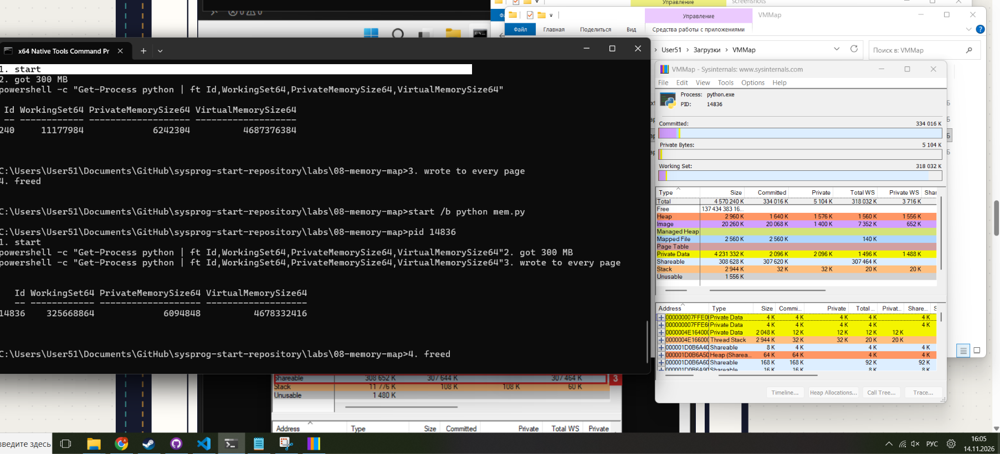
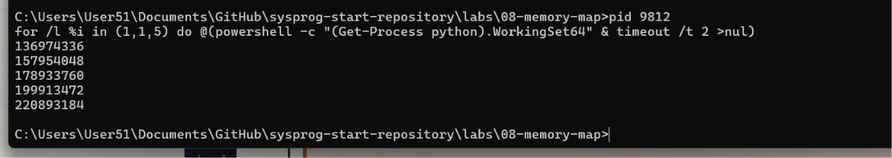

# ЛР 8. Карта памяти

Система: Windows 11
Чем мерил (виртуальная и занятая): PowerShell (`Get-Process python | ft Id,WorkingSet64,PrivateMemorySize64,VirtualMemorySize64`) и VMMap.

## Этапы mem.py
Старт: Обещано (VirtualMemorySize64): 4 372 803 584 байт ~ 4170 МБ (4 ГБ). Занято (WorkingSet64): 11 358 208 байт ~ 10.8 МБ.
Получил 300 МБ:  Обещано (VirtualMemorySize64) 4 687 376 384 байт (до этого было 4 372 803 584 байт, разница в 300 МБ). Занято (WorkingSet64) 11 179 984 байт (до этого было 11 149 312 байт).
Записал в каждую страницу: Обещано: 4 678 332 416 байт (4460 МБ). Занято: 325 668 864 байт (310 МБ).
Освободил: Занято (WorkingSet64) около 10.6 МБ, обещано около 4.1 ГБ. Почти как в шаге 1.
Почему занятая память выросла только на третьем этапе: Программа попросила место под 300 МБ, но не записала ничего туда, но реальная занятая физическая память не изменилась.

## Карта памяти
Из каких частей состоит память процесса: Image (образа программы), Mapped File (отображенных файлов), Shareable (разделяемой память), Heap (кучи), Stack, Page Table и Private Data.

## Утечка
Пять замеров leak.py: 136 974 336, 157 954 048, 178 933 760, 199 913 472, 220 893 184.
На сколько росла память за 2 секунды: 20 979 712 байт, ровно 20 МБ.
Не получилось: всё получилось

## Снимки экрана

Сохраните снимок поверх заглушки в папке `screenshots/` с тем же именем — ссылки ниже менять не нужно.

### 1. Карта памяти
Шаг 2. Видно: карта памяти процесса mem.py на старте и её итог.

### 2. Получено 300 МБ
Шаг 3. Видно: виртуальная память выросла на 300 МБ, занятая — нет.

### 3. Страницы заняты
Шаг 4. Видно: занятая память (в macOS — физический след) после записи в каждую страницу.

### 4. Утечка
Шаг 6. Видно: пять замеров памяти leak.py.

