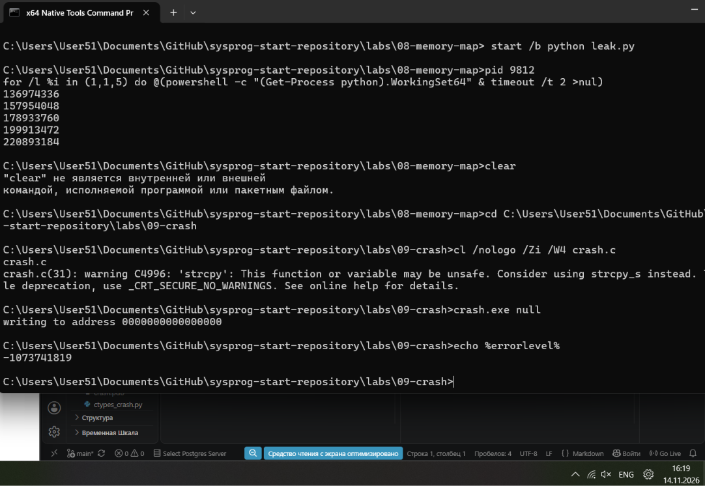
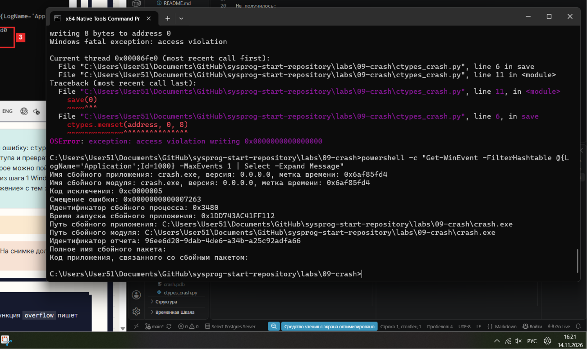
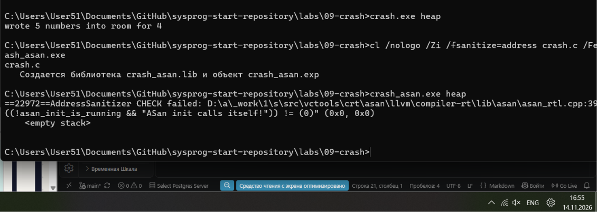
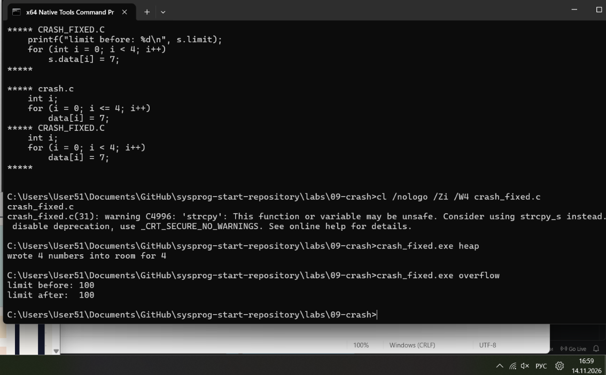

# ЛР 9. Разбор падения

Система: Windows 11
Компилятор: Visual Studio 2019 (MSVC / clang-cl)

## Падение
crash null: что напечатано и код завершения: writing to address 0000000000000000 и код завершения -1073741819
ctypes_crash.py: что напечатал Python: writing 8 bytes to address 0, затем Windows fatal exception: access violation и ошибка OSError: exception: access violation writing 0x0000000000000000.
Где система записала падение: В журнале событий Windows (Application, Event ID 1000) 

## Молчаливые ошибки
crash overflow: limit до и после, код: Значение limit до: 100. Значение limit после: 7. Код завершения: 0.
crash heap без проверки: wrote 5 numbers into room for 4 (код завершения 0)
AddressSanitizer для heap: вид ошибки и строка: есть ошибка инициализации AddressSanitizer CHECK failed: "ASan init calls itself!" - баг старых версий ASan в Visual Studio 2019. Ошибка heap-buffer-overflow (запись за границу массива) не была обнаружена при обычном запуске - программа завершилась успешно, но испортила данные молча
AddressSanitizer для uaf: вид ошибки и две строки: вид ошибки и две строки: Вид ошибки, который назвал AddressSanitizer: heap-use-after-free (использование памяти после её освобождения). Две строки: Строка 32 - где память освобождается (вызов free); Строка 33 - где происходит обращение к этой уже освобожденной памяти (вызов printf). 

## Исправление
Что изменено и что напечатала исправленная программа: В 2 циклах for условие изменили с i <= 4 на i < 4. Раньше цикл делал 5 шагов и записывал 5-й элемент за пределами памяти, выделенной под 4 элемента. Для режима heap напечатала: wrote 4 numbers into room for 4. Для режима overflow напечатала: limit before: 100 и limit after: 100.

Не получилось: Стандартный cl.exe с ASan в VS 2019 (столкнулся с багом инициализации, решил через clang-cl).

## Снимки экрана

Сохраните снимок поверх заглушки в папке `screenshots/` с тем же именем — ссылки ниже менять не нужно.

### 1. Падение
Шаг 1. Видно: запуск crash null и код завершения.

### 2. Падение Python
Шаг 2. Видно: вывод ctypes_crash.py и запись системы о падении.

### 3. Отчёт AddressSanitizer
Шаг 4. Видно: вывод crash heap без проверки и с AddressSanitizer (на Windows с ARM — без проверки).

### 4. Исправление
Шаг 6. Видно: разница файлов и вывод исправленной программы.

